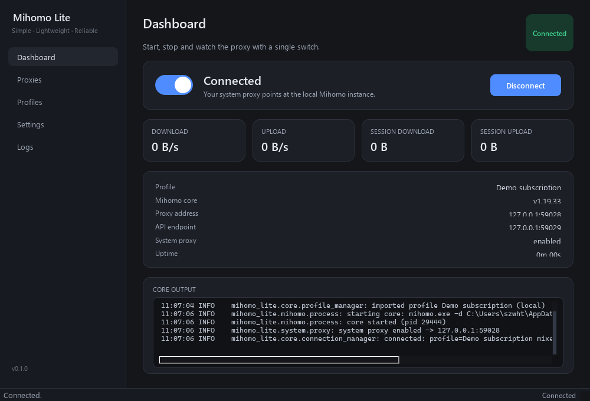
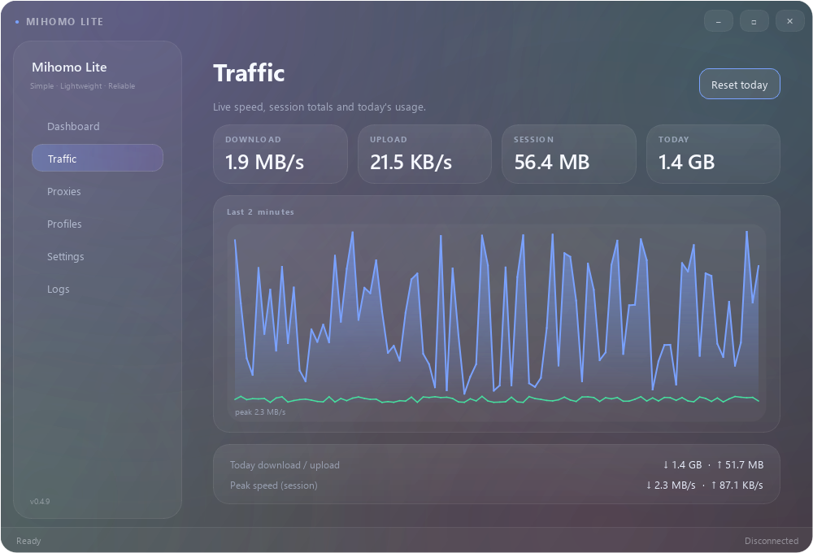
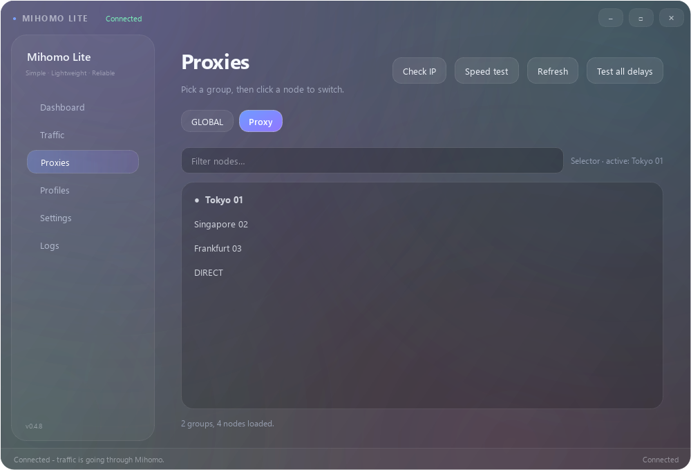
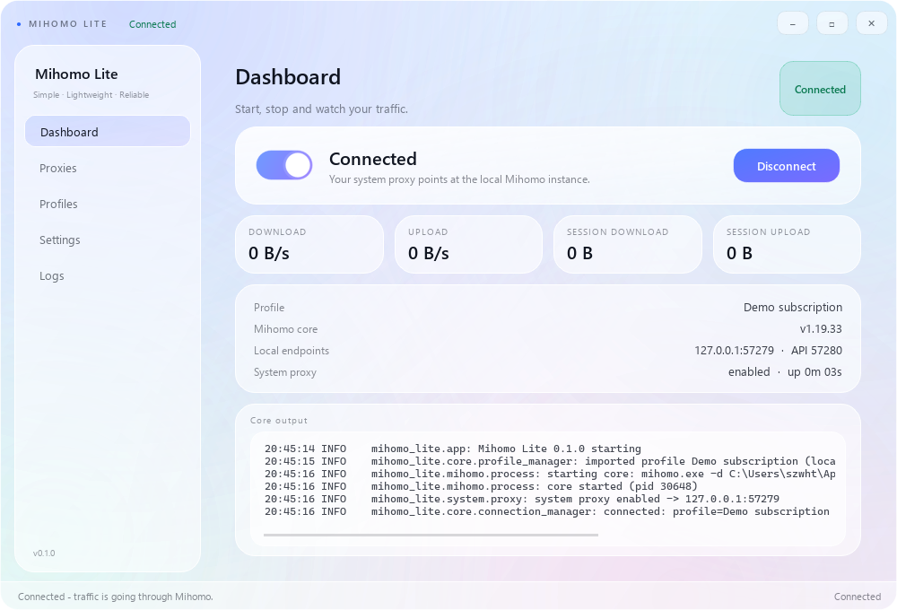

# Mihomo Lite

**Simple. Lightweight. Reliable.**

A liquid-glass Windows client for the [Mihomo](https://github.com/MetaCubeX/mihomo) proxy core.


[English](#english) · [中文](#中文)



| Traffic | Proxies | Light theme |
| --- | --- | --- |
|  |  |  |

---

## English

### What it is

Mihomo Lite is a small Windows desktop client for the Mihomo proxy core. It starts the core,
switches nodes, points the Windows system proxy at it, and puts everything back when you quit.

- **Simple** - connect, pick a node, disconnect. Nothing else in the way.
- **Lightweight** - PySide6 Essentials only, no WebEngine, no background service; TUN is optional and off by default.
- **Reliable** - the previous system proxy state is journalled before it is touched and restored
  on disconnect, on crash, and on the next start after a crash.
- **Open** - MIT application code, about 3k lines you can read in one sitting.

### Features

- Ships with a verified, unmodified Mihomo core (GPL-3.0) and wintun.dll - offline after install
- Downloads are pinned and SHA-256 verified (core, wintun); GitHub Actions are pinned by commit
- Adaptive ports: a busy port is retried automatically (up to 3 attempts) with fresh ports
- Local YAML, subscription URL and QR-code import, with backup and validation
- Routing rule checks before connecting: unknown policies, rules after MATCH, missing
  no-resolve, duplicate rules and undefined rule-providers are reported with line numbers
- A final MATCH rule is appended automatically when a profile has none
- Windows system proxy handling through the WinINET per-connection API
- Crash-safe proxy journal: your original proxy setting survives a hard kill; a dead
  leftover loopback proxy is detected and repaired at startup
- Proxies page with group chips, one-click node switching, a batch latency test across every
  loaded node, sort-by-latency, and a per-group "Previous node" button that survives restarts
- Profiles page with glass cards for multiple subscriptions (active/selected badges, compact
  details), background rule checks with per-update caching, and a tray notification when
  minimising to the tray
- Smoother batch latency testing (coalesced list repaints) and multi-threaded downloads that
  reuse one HTTP connection per node instead of reconnecting for every segment
- Dashboard shows the current node, latency and jitter, session usage, LAN IP,
  a live public-IP monitor and a Rule/Global/Direct outbound switch
- Latency fluctuation chart (last 60 samples, average and jitter)
- Traffic page: live speeds, session and daily totals, rolling 2-minute chart
- Downloads page: ordinary single-threaded downloads are always available
- Optional accelerated downloads: multi-threaded segmented downloads (4-16 threads, resume,
  retries), plus a multi-node mode that carries segments through loopback listeners pinned to
  distinct nodes. Both switches are off by default; multi-node requires multi-threaded
- Optional TUN mode (mixed/system/gVisor stacks) with automatic elevation and wintun setup
- Automatic subscription updates every 1-48 hours, with the previous file kept as a backup
- Frameless rounded window with frosted glass (Windows acrylic) in dark and light
- Refined visual system: larger type scale, gradient cards and primary buttons, colour-coded
  latency, thin scrollbars, 150 ms page fade and a tidier profiles header
- Tray icon, start-with-Windows, single-instance guard, connect on launch
- Log copy/export with secrets redacted, and a live node filter
- English / 中文 interface switch, public IP check and per-node speed test
- macOS-style momentum (inertial) scrolling with a restrained glide (~40 px per notch), and instant node selection feedback
- Scroll wheels never change unfocused inputs (ports, stack, language), preventing accidental edits
- Scroll direction follows the system by default, with an "Invert scroll direction" switch

### Install

1. Download `MihomoLite-Setup-<version>-x64.exe` from the
   [latest release](https://github.com/2778277877778/mihomo-lite/releases/latest), or the portable
   `MihomoLite-<version>-portable-x64.zip` if you prefer no installer.
2. Launch Mihomo Lite and import a profile (local YAML or subscription URL).
3. Press **Connect** on the dashboard.

No core download is needed: the package already contains one. **Settings -> Mihomo core** can
download a newer official build later, or point at your own `mihomo.exe`.

### First run

1. **Profiles** -> *Import YAML...* or *Add subscription...*
2. **Dashboard** -> **Connect** (status turns green, traffic counters start)
3. **Proxies** -> choose a group and a node, or *Test latency*
4. Closing the window keeps the app in the tray; **Quit** from the tray restores your proxy

### Build from source

```powershell
git clone https://github.com/2778277877778/mihomo-lite.git
cd mihomo-lite
py -3.12 -m venv .venv
.\.venv\Scripts\Activate.ps1
pip install -e ".[dev]"

python -m mihomo_lite          # run
pytest                         # 242 tests
ruff check src tests           # lint
```

```powershell
python scripts/build_windows.py              # dist/MihomoLite (core bundled)
python scripts/build_windows.py --installer  # + Inno Setup installer
```

### Release process

Every change ships with a version bump, README details and bilingual release notes; the
checklist lives in [docs/RELEASE.md](docs/RELEASE.md) and `scripts/bump_version.py` keeps
the three version strings in sync.

### How it works

```text
PySide6 UI -> ConnectionManager -> MihomoProcess / MihomoAPI / SystemProxy
                                     |
                               Mihomo core (separate process)
```

- The UI never talks to the core directly; it follows one state machine.
- Imported profiles are never modified. A hardened runtime copy is generated with a
  localhost-only controller, a fresh random secret, TUN disabled and random ports.
- Downloads always go through the local mixed port. Only when multi-node is enabled does the
  runtime copy (never the imported profile) also receive one 127.0.0.1 mixed listener per
  selected node; each listener is pinned to its node and no controller call switches nodes.
- The system proxy is journalled before it changes and replayed on the next start if the
  owning process is gone.

More: [docs/ARCHITECTURE.md](docs/ARCHITECTURE.md), [docs/DEVELOPMENT.md](docs/DEVELOPMENT.md),
[docs/USER_GUIDE.md](docs/USER_GUIDE.md).

### License

Application code: MIT (see [LICENSE](LICENSE)).
The bundled Mihomo core is GPL-3.0 and is redistributed unmodified; source and notices are in
[THIRD_PARTY_NOTICES.md](THIRD_PARTY_NOTICES.md) and `licenses/`.
PySide6 / Qt is used under LGPL-3.0 and is dynamically linked.

### Contributing

Issues and pull requests are welcome. Please read [CONTRIBUTING.md](CONTRIBUTING.md) and
[SECURITY.md](SECURITY.md) first.

---

## 中文

### 这是什么

Mihomo Lite 是一个轻量的 Windows 图形客户端，负责启动 Mihomo 内核、切换节点、设置系统代理，
并在退出时把一切恢复原状。

- **简单**：连接、选节点、断开，没有多余步骤。
- **轻量**：只依赖 PySide6 Essentials，不带 WebEngine、不带后台服务；TUN 为可选项，默认关闭。
- **可靠**：改动系统代理前先写快照，断开、崩溃、崩溃后重启都会恢复原设置。
- **开放**：应用代码 MIT，约 3k 行，一个下午能读完。

### 功能

- 内置经过校验的 Mihomo 内核（GPL-3.0）和 wintun.dll，装完即可离线使用
- 下载物固定版本并做 SHA-256 校验；GitHub Actions 按 commit 固定
- 端口自适应：端口被占用时自动换端口重试（最多 3 次），DNS 监听端口也自动避让
- 本地 YAML、订阅链接、二维码图片导入（先备份、再校验、后替换）
- 连接前检查路由规则：策略名拼错、MATCH 之后还有规则、IP 规则缺 no-resolve、
  重复规则、未定义的 rule-provider，都会按行号提示
- 配置缺少最终 MATCH 时自动补一条，不再依赖内核默认行为
- 通过 WinINET per-connection API 管理 Windows 系统代理
- 崩溃安全的代理日志：强杀进程也不会把你的代理设置弄丢；启动时还会检测并修复残留的
  失效本地代理端口
- 代理页顶部代理组标签 + 节点列表，单击即切换；支持一键测试全部节点延迟、按延迟排序，
  以及跨重启保留的“上一个节点”快捷切换
- 配置页使用玻璃卡片展示多个订阅（当前使用/已选中标识、紧凑详情），规则检查在后台执行
  并按配置更新缓存，最小化到托盘时给出提示
- 全部节点测延迟时列表刷新合批，多线程下载按节点复用 HTTP 连接，减少不必要的重建与握手
- 首页显示当前节点、延迟与波动、本次用量、内网 IP、公网 IP 动态监测，以及 Rule/Global/Direct 出站切换
- 延迟波动图（最近 60 个采样、均值与抖动）
- 流量页：实时速度、本次与今日总量、最近 2 分钟滚动曲线
- 下载页：始终提供普通单线程下载
- 可选下载加速：多线程分段下载（4–16 线程、断点续传、失败重试），以及多节点并行——
  各分段通过绑定到不同节点的 127.0.0.1 listener 传输。两个开关默认关闭，多节点依赖多线程
- 可选 TUN 模式（mixed/system/gVisor 三种栈），自动请求管理员权限并支持在线安装 wintun
- 订阅自动更新（1–48 小时可调），更新前保留上一份配置
- 无边框圆角窗口 + 磨砂玻璃（Windows 亚克力），深浅双主题
- 视觉体系升级：更大字号层级、渐变卡片与主按钮、延迟颜色分级、细滚动条、150ms 页面淡入
- 托盘常驻、开机自启、单实例保护、启动即连接
- 日志一键复制/导出（自动脱敏），节点列表实时过滤
- 中英文界面切换、公网 IP 检测、节点测速
- 类 macOS 的惯性滚动，力度克制（每格约 40px、松手后快速回落），节点切换即时高亮反馈
- 未聚焦的输入控件不会被滚轮误改（端口、TUN 栈、语言等），避免滚动页面时改坏设置
- 滚动方向默认与系统一致，可在设置里勾选"反转滚动方向"适配不同触控板驱动

### 安装

1. 到 [最新 Release](https://github.com/2778277877778/mihomo-lite/releases/latest) 下载
   `MihomoLite-Setup-<版本>-x64.exe`；不想安装就用 `MihomoLite-<版本>-portable-x64.zip`
2. 打开程序，导入配置（本地 YAML 或订阅链接）
3. 在 Dashboard 点 **Connect**

不需要另外下载内核，安装包已内置。以后想升级内核，可在 **Settings -> Mihomo core** 下载新版，
或指定自己的 `mihomo.exe`。

### 三步上手

1. **Profiles** -> *Import YAML...* 或 *Add subscription...*
2. **Dashboard** -> **Connect**（状态变绿，流量开始计数）
3. **Proxies** -> 选策略组和节点，或点 *Test latency*
4. 关闭窗口只是收进托盘；要彻底退出请用托盘菜单的 **Quit**（会自动恢复系统代理）

### 从源码运行

```powershell
git clone https://github.com/2778277877778/mihomo-lite.git
cd mihomo-lite
py -3.12 -m venv .venv
.\.venv\Scripts\Activate.ps1
pip install -e ".[dev]"

python -m mihomo_lite          # 运行
pytest                         # 242 个测试
ruff check src tests           # 代码检查
```

```powershell
python scripts/build_windows.py              # dist/MihomoLite（含内核）
python scripts/build_windows.py --installer  # 额外生成 Inno Setup 安装包
```

### 发布流程

每次更新都会同步：版本号、README 细节、中英双语 Release 说明；清单见
[docs/RELEASE.md](docs/RELEASE.md)，版本号用 `scripts/bump_version.py` 统一修改。

### 工作原理

```text
PySide6 界面 -> ConnectionManager -> MihomoProcess / MihomoAPI / SystemProxy
                                        |
                                  Mihomo 内核（独立进程）
```

- 界面不直接操作内核，只观察唯一的状态机。
- 下载始终经过本地 mixed 端口；只有开启多节点时，运行副本（不是导入的配置）才会为每个
  选中节点额外生成一个只监听 127.0.0.1 的 mixed listener，每个 listener 固定走指定节点，
  不调用 controller 切换节点。
- 导入的配置永不修改；运行时另生成加固副本：内核只监听 127.0.0.1、每次随机 secret、
  关闭 TUN、端口随机。
- 系统代理改动前写 journal；若进程异常退出，下次启动自动还原。

更多文档：[docs/ARCHITECTURE.md](docs/ARCHITECTURE.md)、[docs/DEVELOPMENT.md](docs/DEVELOPMENT.md)、
[docs/USER_GUIDE.md](docs/USER_GUIDE.md)。

### 许可证

应用代码：MIT（见 [LICENSE](LICENSE)）。
内置的 Mihomo 内核为 GPL-3.0，原样分发；源码地址与声明见 [THIRD_PARTY_NOTICES.md](THIRD_PARTY_NOTICES.md)
以及 `licenses/` 目录。PySide6 / Qt 使用 LGPL-3.0，动态链接。

### 贡献

欢迎提 Issue 和 PR，请先阅读 [CONTRIBUTING.md](CONTRIBUTING.md) 与 [SECURITY.md](SECURITY.md)。
