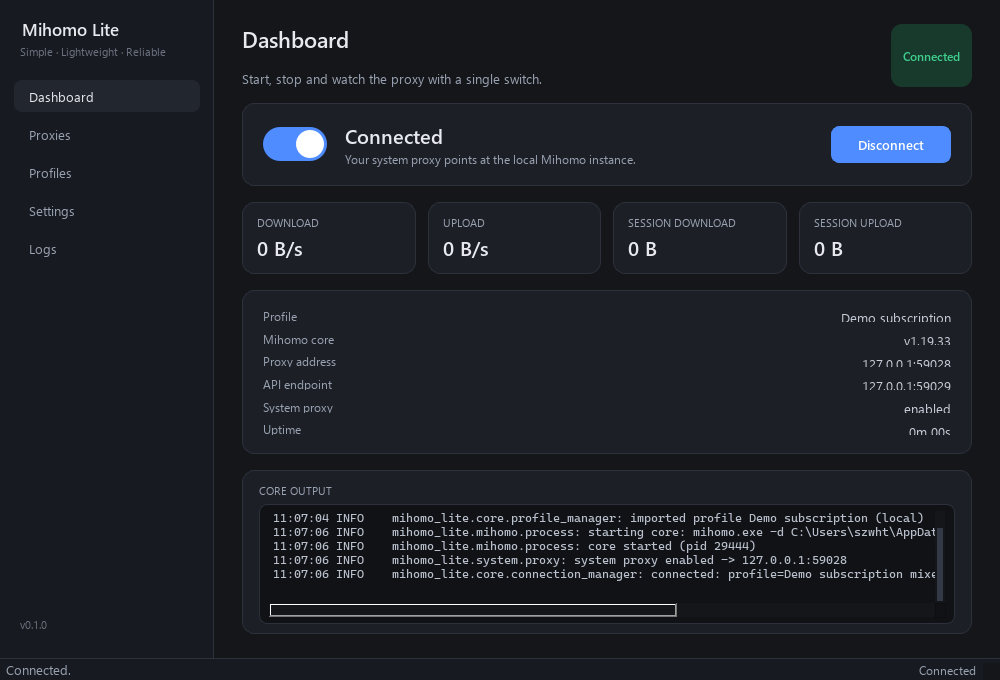

# Mihomo Lite v0.4.1

> Simple. Lightweight. Reliable. A liquid-glass Windows client for the Mihomo core.

## English

### What's new in this line

- **Traffic page** - live speeds, session and daily totals, rolling 2-minute chart.
- **Latency fluctuation chart** - last 60 samples of the current node with average and jitter.
- **Dashboard** - current node, latency, session usage, LAN IP, live public-IP monitor
  (60 s refresh) and Rule / Global / Direct switching.
- **Proxies rebuilt** - group chips, one-click node switching, per-node latency + jitter,
  and a single "Test all delays" action.
- **QR import** for subscriptions and inline YAML, plus base64 and Clash User-Agent
  negotiation for picky providers.
- **Force stop core** with system-proxy restore.

### Security

- Core and wintun are pinned and SHA-256 verified; both ship inside the package.
- GitHub Actions pinned by commit SHA; release tag passed via environment variable.
- Subscription tokens and API secrets are redacted from logs and UI.

### Install

1. Download `MihomoLite-Setup-0.4.1-x64.exe` (installer) or
   `MihomoLite-v0.4.1-portable-x64.zip` (portable).
2. Import a profile (local YAML, subscription URL or QR image).
3. Press **Connect**.

Windows 10/11 x64. The installer is not code-signed yet, so SmartScreen may ask for
"More info -> Run anyway". Mihomo core v1.19.33 (GPL-3.0) and wintun 0.14.1 (GPL-2.0)
are bundled unmodified; licences are included in the package.

### Verify

`SHA256SUMS.txt` is attached to this release. `MihomoLite.exe --version` prints the version.

---

## 中文

### 本版内容

- **流量页**：实时速度、本次与今日总量、最近 2 分钟滚动曲线。
- **延迟波动图**：当前节点最近 60 次采样，附均值与抖动。
- **首页**：当前节点、延迟、本次用量、内网 IP、公网 IP 动态监测（60 秒刷新）、
  Rule / Global / Direct 出站切换。
- **代理页重构**：顶部代理组标签、单击切换节点、节点延迟与波动、一键"全部测延迟"。
- **二维码导入**：订阅链接与内联 YAML，同时支持 base64 订阅与 Clash User-Agent 协商。
- **强制结束内核**：同时恢复系统代理。

### 安全

- 内核与 wintun 固定版本并做 SHA-256 校验，随安装包分发。
- GitHub Actions 按 commit SHA 固定，发布 tag 通过环境变量传递。
- 订阅 token 与 API 密钥在日志和界面中脱敏。

### 安装

1. 下载 `MihomoLite-Setup-0.4.1-x64.exe`（安装版）或 `MihomoLite-v0.4.1-portable-x64.zip`（便携版）。
2. 导入配置（本地 YAML、订阅链接或二维码图片）。
3. 点 **Connect**。

支持 Windows 10/11 x64。安装包暂未签名，SmartScreen 提示时选"更多信息 -> 仍要运行"。
内置未修改的 Mihomo v1.19.33（GPL-3.0）与 wintun 0.14.1（GPL-2.0），许可文件随包提供。

### 校验

本 Release 附带 `SHA256SUMS.txt`；`MihomoLite.exe --version` 可查看版本号。
